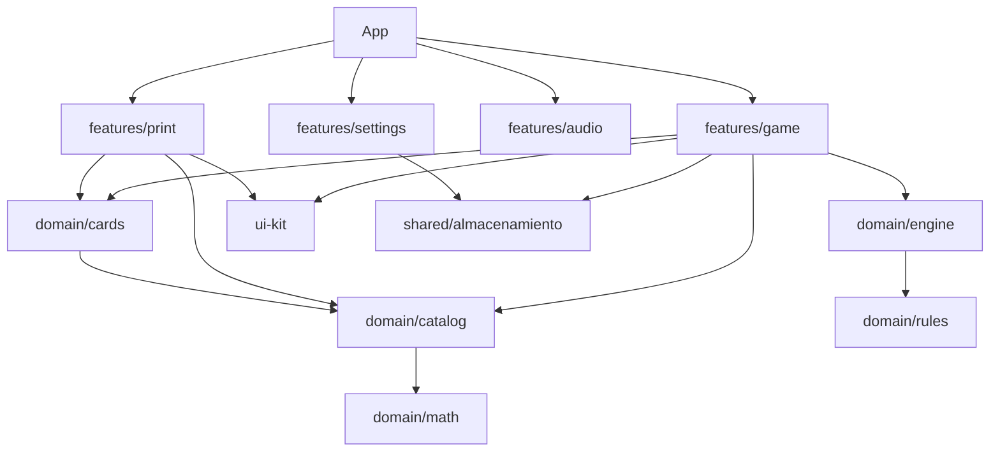

# Liga del Álgebra

Liga del Álgebra es un bingo educativo para practicar factorización de polinomios en grado octavo.

Proyecta polinomios sin repetirlos y permite que los estudiantes los marquen en cartones impresos.

La aplicación identifica ganadores, muestra las respuestas y funciona sin cuentas ni servidor de juego.

## Requisitos

- Node.js **20.19+ o 22.12+** (probado en Node v24.13.0).
- Navegador moderno con JavaScript, impresión y almacenamiento local habilitados.
- No usa backend, inicio de sesión ni servicios externos durante una partida.

## Ejecutar en desarrollo

```bash
npm install
npm run dev
```

Abre la dirección local que muestre Vite, normalmente `http://localhost:5173/`.

Comprobaciones disponibles:

```bash
npm test
npm run validar
npm run contraste
npm run lint
npm run build
```

## Usar en clase

1. En **Imprimir cartones**, elige todos, uno o un rango y selecciona 1 o 2 cartones por página. La opción inicial es 2 por página.
2. En el inicio también puedes abrir **Imprimir fichas genéricas**: prepara 50 fichas sin ejercicios, en dos planchas de 5×5, con el tamaño de las casillas del formato de 2 cartones por página. Recórtalas y colócalas sobre las casillas.
3. En el diálogo de impresión elige papel **Carta**, escala **100 %** y desactiva encabezados y pies del navegador. Imprime los cartones en blanco y negro; activa gráficos de fondo para conservar los colores de las fichas.
4. Proyecta la app y pulsa **¡Comenzar!**. Ese clic habilita la música, si está activada. También puedes continuar una partida guardada.
5. Pulsa **Sortear siguiente**. El historial, la ronda y las posiciones se actualizan; cada polinomio aparece una vez por partida.
6. **Mostrar respuesta** revela el caso, la factorización y una explicación. Úsalo como apoyo docente; la respuesta permanece oculta al inicio de cada turno.
7. **Verificar cartón** permite revisar un cartón del 1 al 30 contra los polinomios sorteados.
8. Al aparecer el podio se listan todos los cartones ganadores del mismo turno. Puedes cerrar, iniciar otra partida o continuar para buscar el siguiente puesto.
9. En **Ajustes de pantalla y sonido** controla reproducción, volumen, silencio, efectos y animaciones. Las preferencias se guardan en este navegador.

El avance de la partida también se guarda localmente en el navegador. No se sincroniza entre equipos.

## Compilar y usar sin conexión

```bash
npm run build
npm run preview
```

Vite muestra una dirección local para la versión de producción. La pista de audio está incluida en `dist/audio/` y se sirve desde el mismo proyecto; una vez instalado y compilado, el juego no necesita conexión a Internet.

Abrir `dist/index.html` con doble clic (`file://`) puede fallar porque el navegador restringe módulos ES. Usa `npm run preview` o un servidor estático local. Para generar un único archivo HTML se tendría que evaluar un plugin adicional y revisar su impacto antes de instalarlo.

## Catálogo y cartones

Los ejercicios viven en `src/domain/catalog/ejercicios.data.js` y los 30 cartones generados en `src/domain/cards/cartones.data.js`. Si modificas el catálogo, sigue este orden:

```text
editar ejercicios.data.js
npm test
npm run cartones
npm test
npm run validar
imprimir los cartones nuevos
```

**Al cambiar el catálogo o regenerar cartones hay que reimprimir los 30 cartones y reemplazar los anteriores.** La versión impresa se muestra en cada cartón (`C-da4284d4` para los datos actuales). No edites `cartones.data.js` a mano.

## Cambiar la regla de victoria

La regla por defecto se exporta como `REGLA_POR_DEFECTO` desde `src/domain/rules/index.js`. Puedes reemplazar `cartonCompleto` por una de las reglas exportadas: `fila`, `columna`, `diagonal` o `cualquierLinea`. Después ejecuta `npm test`, `npm run validar` y prueba una partida completa antes de usarla en clase.

## Arquitectura



- `domain/math → catalog → cards`; `domain/engine` recibe mazo/cartones/regla desde la feature de juego y `domain/rules` es independiente. Dominio puro, sin React ni DOM.
- `features/*` puede usar `ui-kit` y módulos públicos del dominio; las features se coordinan desde `App.jsx` y no se importan entre sí.
- `features/game` contiene interfaz y hook de partida; `features/print` solo presenta cartones; `features/audio` gestiona audio local y efectos; `features/settings` guarda preferencias mediante `shared/almacenamiento.js`.
- La lógica del dominio se prueba con `node:test`, independiente de React.

## Limitaciones conocidas

- **Dificultad configurable:** cada ejercicio tiene nivel, pero los cartones actuales combinan niveles. Filtrar el mazo rompería la correspondencia con los cartones impresos. Una modalidad por nivel requiere generar y distribuir un juego de cartones distinto para cada nivel.
- **Casos no vistos:** si el grupo aún no estudió uno de los seis casos, quítalo del catálogo, regenera y valida los cartones, y vuelve a imprimir todos. No filtres ejercicios solo durante una partida.
- **Alcance matemático:** una variable (`x`) y coeficientes enteros pequeños; no incluye fracciones ni raíces.
- **Estado local:** partida y ajustes se guardan en el navegador actual; borrar datos o cambiar de equipo no los sincroniza.
- La impresión y legibilidad final dependen del navegador, escala, papel y configuración de la impresora.

## Créditos y licencias

Música: “Happy Happy Game Show” Kevin MacLeod (incompetech.com).

```text
"Happy Happy Game Show" Kevin MacLeod (incompetech.com)
Licensed under Creative Commons: By Attribution 4.0 License
http://creativecommons.org/licenses/by/4.0/
```

El archivo se recodificó a 128 kb/s, sin recorte ni mezcla. Fuente, licencia, permisos y registro de candidatas revisadas: [`public/audio/LICENCIAS.md`](public/audio/LICENCIAS.md). La licencia permite redistribuir y adaptar el material con atribución; consulta sus [términos oficiales CC BY 4.0](https://creativecommons.org/licenses/by/4.0/).

## Solución de problemas

- **No se oye la música:** pulsa “¡Comenzar!” o “Reproducir música”, quita silencio y revisa volumen del navegador y del sistema.
- **Impresión recortada o pequeña:** usa Carta, escala 100 %, márgenes normales y desactiva encabezados y pies del navegador.
- **Reiniciar partida y ajustes guardados:** abre las herramientas de desarrollo del mismo navegador y ejecuta en la consola:

  ```js
  localStorage.removeItem('liga-algebra.partida.v1')
  localStorage.removeItem('liga-algebra.ajustes.v1')
  location.reload()
  ```

- **Revisar resultados manuales pendientes:** consulta [`docs/QA.md`](docs/QA.md). La revisión visual en navegador, impresión física y partidas piloto aún requieren comprobación humana.

## Documentación

- [Decisiones del proyecto](docs/DECISIONES.md)
- [Inspección del entorno](docs/INSPECCION.md)
- [Informe QA](docs/QA.md)
- [Informe de fase 6: impresión](docs/FASE-6.md)
- [Informe de fase 7: audio](docs/FASE-7.md)
